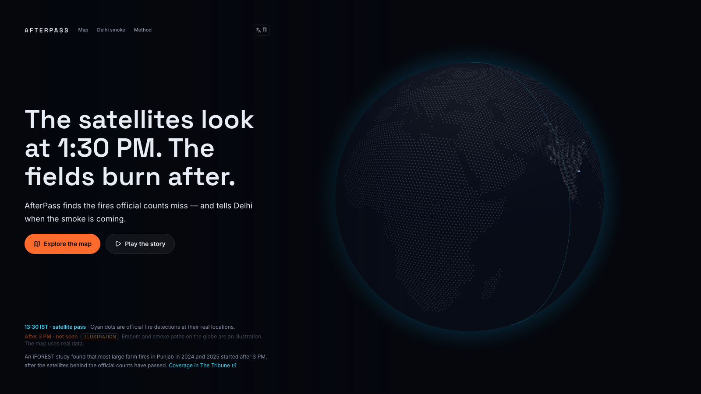
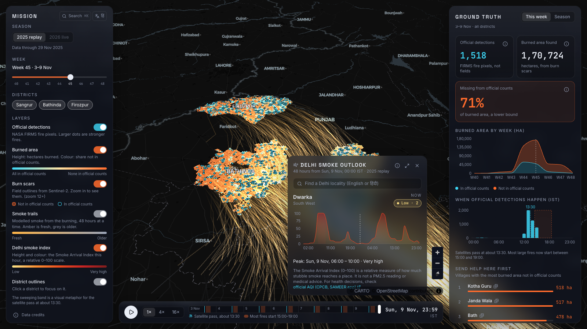
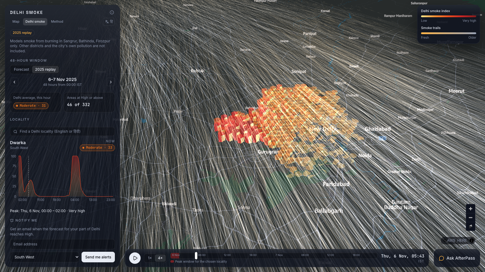
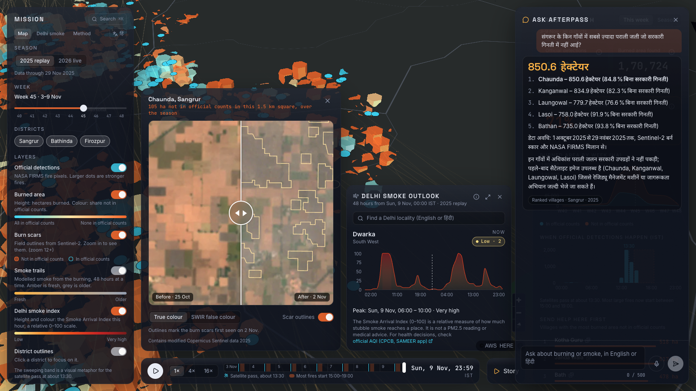
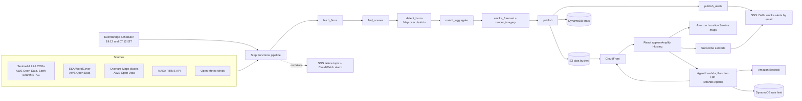

# AfterPass

**What burns after the satellite passes.**

Official stubble-fire counts for Punjab come from satellites that pass over at about 1:30 PM
IST. Most large farm fires are now lit after 3 PM, so they never enter the count. AfterPass
finds those fires from the burn scars they leave behind, shows where the burning missing from
official counts is concentrated, and tells Delhi when the smoke is coming.

- **App:** https://main.dx6zgy1knro1d.amplifyapp.com
- **Data:** https://d1350fsjwyfixs.cloudfront.net/latest.json
- Built for the WeMakeDevs × AWS *Environmental Hacks* (Bharat Builds Tour), Air track.



## What it does

1. **Finds burned fields** in Sentinel-2 imagery. A scar stays visible for days, whatever the
   hour the field was lit.
2. **Compares them with NASA FIRMS** official detections, to show the burned area missing from
   official counts, by district and village.
3. **Forecasts where the smoke goes** over the next 48 hours and which Delhi neighbourhoods it
   reaches.
4. **Answers questions in English and Hindi** through an assistant that also drives the map.

It is for directing help (crop-residue machines, awareness work) to where uncounted burning
concentrates, and for warning Delhi residents. It is not a tool for fines: results are shown
for villages and districts only, and "not in official counts" describes the satellites'
timing, not anyone's intent.

## Results: 2025 replay

Sangrur, Bathinda and Firozpur, 1 October to 30 November 2025. Each figure names the file it
comes from.

| Finding | Value | Source |
|---|---|---|
| Burned area found | 423,996 ha | `seasons/2025/summary.json` |
| Not in official counts | 303,189 ha (71%) | `seasons/2025/summary.json` |
| Official detections between 12:00 and 16:00 IST | 4,330 of 4,377 (98.9%) | `seasons/2025/summary.json` |
| Daily Delhi smoke index vs observed PM2.5, 59 days, 40 monitors | Pearson r = 0.56, Spearman ρ = 0.63 | `validation/2025.json` |
| Visual precision check | Not done yet | `reports/qa_sheet.html` |

The burned area is a lower bound: clouds leave gaps, fields under 0.5 ha are missed, and a
field tilled under before the next clear image is not seen. The PM2.5 comparison shows that the
two move together. Part of that is shared weather (the mixing layer), so it does not measure
how much PM2.5 the smoke adds. [docs/METHOD.md](docs/METHOD.md) explains the method and all
the limits.

| Explorer | Delhi smoke | Ask AfterPass |
|---|---|---|
|  |  |  |

## Architecture

Everything runs in the Sydney region (`ap-southeast-2`), the only region the hackathon account
can create resources in. Sentinel-2 and Overture are read from AWS Open Data in `us-west-2`;
CloudFront serves the results to India.



The pipeline's state machine is in
[infra/statemachine/pipeline.asl.json](infra/statemachine/pipeline.asl.json) and the stack in
[infra/template.yaml](infra/template.yaml). Every pipeline function runs from one container
image built from [backend/Dockerfile](backend/Dockerfile).

### How AWS is used

| Area | AWS services | What for |
|---|---|---|
| AWS Open Data | Sentinel-2 L2A, ESA WorldCover, Overture Maps | Imagery for burn scars, the cropland mask, village and Delhi locality names |
| Compute and orchestration | Lambda (arm64, container image), Step Functions, EventBridge Scheduler | The daily pipeline: detection per district in a Map state, then matching, smoke, imagery, publishing, alerts |
| Storage and delivery | S3, CloudFront | Public data files and imagery, cached and compressed for India |
| Data and alerts | DynamoDB, SNS | Daily district statistics and the assistant's rate limit; Delhi smoke alerts by email, filtered by zone |
| AI | Amazon Bedrock via **Strands Agents** | The bilingual assistant. It runs on `openai.gpt-oss-120b`, because the account has no Claude quota; the code switches to a Claude model with one setting (`AGENT_MODEL`) |
| Maps and hosting | Amazon Location Service, Amplify Hosting | Dark basemap with India's political view; the web app |
| Operations | CloudWatch, CloudFormation (SAM) | Logs with 14-day retention, an alarm on pipeline failures, one template for the whole stack |

### Status

| Part | State |
|---|---|
| Web app on Amplify, data on S3 and CloudFront | Live |
| Assistant on Lambda | Live; 10 of 10 scripted questions grounded ([transcript](backend/agent/tests/transcript.md)) |
| 2025 replay and the 2026 season so far | Published |
| Daily pipeline, alerts, "Notify me" | Template and image validated; deploy with `make deploy` |

## Run it locally

Needs Python 3.12 with [uv](https://docs.astral.sh/uv/), Node 20+, and a free
[NASA FIRMS MAP_KEY](https://firms.modaps.eosdis.nasa.gov/api/map_key/).

```bash
make setup                 # backend (uv) and frontend (npm) dependencies
cp .env.example .env       # add FIRMS_MAP_KEY; OPENAQ_API_KEY only for the PM2.5 check
make test                  # lint and unit tests

make replay                # 2025 season: detect, match, aggregate, publish to data/public/
make imagery               # before/after crops for the top 20 villages
make smoke                 # smoke replay: one 48-hour run per day
make serve-data            # serves data/public on :8787
make web                   # the app on :5173
make agent                 # the assistant on :8788 (calls Bedrock; needs AWS credentials)
make walkthrough           # scripted check of the whole app, with screenshots
```

Downloads are cached under `data/cache/`, so every step can be stopped and resumed.

On AWS, with credentials for the account and `ALERT_EMAIL` set in `.env` (where pipeline
failure emails go). `make deploy` asks before it creates anything:

```bash
make deploy                # the SAM stack in ap-southeast-2
make pipeline-run          # one full pipeline run (about $0.30)
make schedule-on           # the daily runs at 19:12 and 07:12 IST
make deploy-web            # build the app against the stack and upload to Amplify
make destroy               # delete the stack (the data bucket is kept)
```

## Repository

```
backend/afterpass/   detection, matching, aggregation, smoke model, publishing, CLI
backend/agent/       the assistant: tools, prompt, grounding check, Lambda handler
backend/lambdas/     thin pipeline and subscribe handlers
frontend/            React app: hero globe, Explorer map, Delhi screen, Method page, story
infra/               SAM template and the Step Functions definition
docs/                METHOD.md, DEMO_SCRIPT.md, BLOG_DRAFT.md
validation/          calibration, PM2.5 comparison and QA sample for each season
reports/             screenshots, calibration plot, quick-looks
```

## Limitations

- Burned area is a lower bound (clouds, a 2 to 5 day revisit, fields under 0.5 ha).
- The hour a field was lit is unknown; a scar is dated by the image that first showed it.
- Villages are the nearest named place within 3 km of a scar, not administrative boundaries.
- The Smoke Arrival Index is relative, covers only the mapped districts, and is not a PM2.5
  forecast or health advice. For health decisions, use official AQI (CPCB's SAMEER app).
- Precision from the visual check is not known until the QA sheet is labelled.

## Credits

- Contains modified Copernicus Sentinel data 2025–2026.
- We acknowledge the use of data and imagery from LANCE FIRMS operated by NASA's Earth Science
  Data and Information System (ESDIS) with funding provided by NASA Headquarters.
- © ESA WorldCover project 2021 / Contains modified Copernicus Sentinel data (2021) processed by
  ESA WorldCover consortium.
- Weather data by [Open-Meteo.com](https://open-meteo.com/) (CC BY 4.0).
- © OpenStreetMap contributors, Overture Maps Foundation.
- District boundaries: [geoBoundaries](https://www.geoboundaries.org/) (CC BY 4.0).
- Country outlines on the globe: [Natural Earth](https://www.naturalearthdata.com/).
- PM2.5 observations: CPCB and DPCC monitors, via [OpenAQ](https://openaq.org/).
- Basemap: Amazon Location Service.
- The after-3 PM finding: iFOREST, as reported in
  [The Tribune](https://www.tribuneindia.com/news/delhi/satellites-miss-majority-of-stubble-fires-delhi-air-pollution-underestimated-report).
