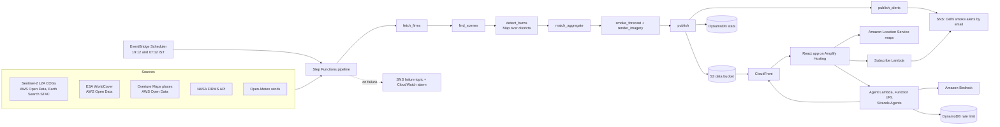

# Architecture

AfterPass has three parts: a daily pipeline that turns satellite data into small published
files, a web app that reads those files, and an assistant that answers from the same files.
Nothing the app shows is computed in the browser or by the model; it is all read from what the
pipeline published.

Everything runs in the Sydney region (`ap-southeast-2`), the only region the hackathon account
can create resources in. Sentinel-2 and Overture are read from AWS Open Data in `us-west-2`.

## The pipeline

One Step Functions state machine
([infra/statemachine/pipeline.asl.json](../infra/statemachine/pipeline.asl.json)) runs the
live season. Every step is a Lambda function from the same container image
([backend/Dockerfile](../backend/Dockerfile)); the handlers in
[backend/lambdas/pipeline.py](../backend/lambdas/pipeline.py) are thin and call the same
`afterpass` package that runs on a laptop.

| Step | What it does | Memory, time limit |
|---|---|---|
| `fetch_firms` | Downloads the season's official detections for the region | 1,024 MB, 5 min |
| `find_scenes` | Lists the Sentinel-2 dates each district needs | 1,024 MB, 2 min |
| `detect_burns` | One call per district, up to three at once: caches the scenes, detects the scars and matches them with official detections | 3,008 MB, 15 min |
| `match_aggregate` | Assigns villages, aggregates to H3 cells and weeks, writes the season's public files and the daily statistics | 3,008 MB, 10 min |
| `smoke_forecast` | The 48-hour smoke forecast from recent scars and today's detections | 3,008 MB, 10 min |
| `render_imagery` | Before and after crops for the season's top 20 villages; runs alongside the forecast | 3,008 MB, 15 min |
| `publish` | Clears the CloudFront cache for the new files | 512 MB, 1 min |
| `publish_alerts` | Emails subscribers for each Delhi zone whose forecast reaches High (index 50 or more) | 1,024 MB, 2 min |

- **Two kinds of run.** The evening run (19:12 IST, after FIRMS has processed the afternoon
  pass) does everything. The morning run (07:12 IST) only refreshes the smoke forecast.
- **The schedules are created switched off.** `make schedule-on` starts them; `make
  pipeline-run` starts one run by hand.
- **Retries and failures.** Most steps retry two or three times. If a step still fails, the
  run emails the failure topic and a CloudWatch alarm fires.
- **Resumable.** Lambda's only writable disk is `/tmp`, so each step pulls what it needs from
  the bucket's `cache/` prefix and pushes back what it downloaded. A retry, or the next day's
  run, does not download a Sentinel-2 date twice.
- **Measured.** The first full run, on 12 October 2026, took 5 min 51 s and 1,425 GB-seconds
  of Lambda time, about $0.02. Runs get longer as the season adds imagery.

The 2025 replay season was computed on a laptop with the same code and uploaded.

## Published data

One S3 bucket, private, read only through CloudFront:

| Prefix | Contents |
|---|---|
| `public/` | What CloudFront serves. `latest.json` lists the seasons; `seasons/{season}/` holds the summary, villages, H3 cells, scars by district and week, and official detections; `smoke/{run_id}/` holds one 48-hour run; `imagery/{season}/` holds the village crops; `validation/{season}.json` holds the checks; `METHOD.md` is the method document the assistant quotes |
| `cache/` | The pipeline's working files: Sentinel-2 scenes on each district's grid, FIRMS downloads, intermediate results |
| `deploy/` | Lambda code and the image's source bundle |

JSON is gzipped at upload and cached for five minutes; imagery is cached for a day. Every
JSON file carries `generated_at` and the versions of its sources, so any number on screen can
be traced to a file and a time. The file formats are typed in
[frontend/src/lib/types.ts](../frontend/src/lib/types.ts).

## The app

A React single-page app (Vite, TypeScript, deck.gl on MapLibre) on Amplify Hosting. It reads
the published files from CloudFront and draws the basemap from Amazon Location Service, with
India's political view. It calls two Lambda Function URLs: the assistant, and the "Notify me"
form, which subscribes an email address to the Delhi smoke topic with a filter for one zone.

## The assistant

A Lambda function running [Strands Agents](https://strandsagents.com) against Amazon Bedrock
([backend/agent/](../backend/agent/)).

- **Six tools**, each reading the published files over CloudFront: `season_overview`,
  `top_unrecorded_villages`, `district_trend`, `official_detection_times`, `smoke_outlook` and
  `method_and_limits`. A tool returns data for the model and actions for the map.
- **Grounding check.** Every number in an answer must appear in that turn's tool results or in
  the question. An answer that fails is retried once. The check is mechanical: it catches an
  invented figure, not a true figure used for the wrong thing.
- **Rate limit.** 20 questions an hour per address, counted in DynamoDB against a hash of the
  address, with rows that expire.
- **Model.** `openai.gpt-oss-120b` through Bedrock's OpenAI-compatible endpoint, because the
  account has no Claude quota. `AGENT_MODEL` switches it.

## Building and deploying

| What | How |
|---|---|
| Pipeline image | Built inside AWS by CodeBuild ([infra/build.yaml](../infra/build.yaml), `make image`) and stored in ECR. The build imports every pipeline module, so a missing system library fails the build, not a run |
| Stack | One SAM template ([infra/template.yaml](../infra/template.yaml), `make deploy`), which takes the image by digest |
| Secrets | The FIRMS key is an encrypted parameter in SSM Parameter Store; nothing secret is in the repository or the template |
| Data | `make publish-s3` mirrors a local season to the bucket. It refuses to replace a newer run published by the pipeline |
| App | `make deploy-web` builds the frontend against the stack's outputs and uploads it to Amplify |

## Limits of this account

- Resources can be created only in `ap-southeast-2`.
- Lambda memory stops at 3,008 MB. Burn detection for the largest district peaked just under
  that on Lambda, so it has little headroom; if it is ever stopped, the step to split is
  `detect_burns`, one call per image date.
- Ten Lambda functions can run at once across the account.
- No Claude model has quota on Bedrock.
